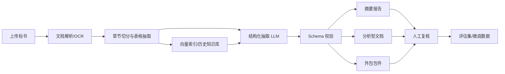

# AI 标书分析工具实施方案

## 目标定位

工作台支持上传标书、AI 解析、结构化报告与跨部门协同。系统帮助商务、技术和项目团队在 PDF / Word 标书中定位报价、技术要求、交货期、废标项和外包边界。

首版建议采用“大模型结构化抽取 + 检索增强 + 人工复核闭环”，不要一开始就重训练一个完整 NLP 模型。这样能更快交付 MVP，同时把历史标书和人工修订沉淀成后续微调数据。

## 核心用户流程

1. 销售上传 PDF / Word / 扫描件标书。
2. 系统完成 OCR、版式解析、表格抽取、章节切分和附件识别。
3. AI 生成两个输出：
   - 摘要版本：压缩重复和制式内容，保留管理层决策信息。
   - 分析型文档：结构化呈现报价清单、技术要求、项目时间、合规风险、外包建议。
4. 技术顾问、项目经理、采购、质量在同一报告中确认责任项。
5. 人工修订结果回写为训练与评估数据。

## 功能模块

| 模块 | 能力 | 首版范围 |
| --- | --- | --- |
| 文件上传 | 支持 PDF、Word、扫描件、附件包 | 单文件上传、版本记录、权限控制 |
| 文档解析 | OCR、表格、目录、页码、章节、附件 | 保留来源页码和原文证据 |
| 关键抽取 | 报价、技术要求、交货期、保证金、质保、废标项 | 使用 JSON schema 约束输出 |
| 摘要生成 | 删除重复模板，形成管理层摘要 | 输出 8-12 条要点 |
| 分析文档 | 报价清单、技术矩阵、时间计划、风险清单 | 支持导出 Word / PDF |
| 外包识别 | 检测、运输、安装、防腐、电控、调试等包件 | 输出供应商询价边界 |
| 人工复核 | 字段确认、纠错、评论、版本差异 | 复核数据入库 |
| 知识库 | 历史标书、技术偏离、报价经验、标准条款 | 检索增强与相似项目对比 |

## 推荐 AI 架构

### 关键设计

- 文档解析层：PDF 文本层优先，扫描件走 OCR；Word 使用结构化解析，表格保留行列关系。
- Chunk 策略：按目录、章节标题、页码和表格边界切分，而不是固定长度粗切。
- 证据追溯：每个抽取字段保存来源页码、章节、原文片段和置信度。
- 结构化输出：使用 JSON Schema 约束字段，减少自由文本漂移。
- 检索增强：把历史标书、标准技术响应、报价模板、偏离处理经验放入知识库。
- 人机协同：高风险条款必须人工确认，确认结果进入评估与训练数据。

## 模型策略

### 阶段 1：不微调，先建立基线

使用通用大模型进行结构化抽取、摘要和报告生成，配合检索增强、提示词模板、规则校验和人工复核。这个阶段的重点是建立字段 schema、标注规范和评估集。

### 阶段 2：领域适配

当累计足够多的“原文 -> 标准 JSON -> 人工修订”样本后，再考虑微调或训练行业抽取模型。适合微调的任务包括：

- 标书章节分类。
- 技术要求、商务条款、废标项抽取。
- 按标书所属行业归一化性能、资质、检验和验收术语。
- 相似项目报价项映射。

### 阶段 3：组合模型

生产环境建议组合使用：

- 大模型：摘要、复杂条款理解、跨章节推理。
- 小模型/BERT 类模型：章节分类、命名实体识别、术语标准化。
- 规则引擎：保证金、日期、金额、废标关键词、必填字段校验。
- 检索系统：历史项目对比和标准响应引用。

## 数据建设

| 数据类型 | 用途 | 建议动作 |
| --- | --- | --- |
| 历史标书原文 | 解析、检索、训练 | 去重、脱敏、按行业/客户/年份分类 |
| 人工分析报告 | 监督样本 | 对齐原文证据和字段 |
| 报价清单 | 商务抽取与成本对比 | 统一单位、币种、税率、成本科目 |
| 技术响应表 | 技术要求识别 | 建立术语词典和同义词表 |
| 中标/未中标结果 | 质量评估 | 分析报价、偏离、交期对结果的影响 |
| 外包采购记录 | 包件推荐 | 沉淀供应商类型、交付物、风险项 |

## 结构化字段

首版字段见 `docs/extraction-schema.json`。建议重点覆盖：

- 项目基本信息：项目名、业主、行业、投标截止、文件语言。
- 商务：报价、付款、保证金、质保、税费。
- 技术：性能、安全、质量、验收和资料交付。
- 工期：交货期、里程碑、现场安装调试。
- 合规：必须响应项、偏离项、缺失项。
- 风险：等级、影响、缓解动作、责任部门。
- 外包：包件范围、触发依据、交付物、供应商类型。

## 系统开发路线

### 1. 前期准备，1-2 个月

- 收集 100-300 份历史标书和对应人工报告。
- 完成脱敏、OCR 质量检查、文件分类、字段定义。
- 建立 30-50 份金标准评估集。
- 确认权限、内网/云端部署边界和数据留存策略。

### 2. 模型与抽取基线，2-3 个月

- 打通文档解析、chunk、检索和 LLM 结构化输出。
- 建立摘要、分析文档、外包识别提示词模板。
- 建立字段准确率、召回率、证据命中率、人工修订率指标。
- 对高频错误增加规则校验和提示词修正。

### 3. 系统开发与集成，3-4 个月

- 开发上传页面、任务队列、结果页、报告导出、人工复核。
- 接入用户权限、审计日志、通知、历史项目库。
- 与销售、技术、项目、采购、质量流程对齐。
- 对大文件和多并发任务做异步处理。

### 4. 测试与优化，2 个月

- 用真实标书跑内部试点。
- 对比人工分析耗时和 AI 输出准确率。
- 收集各部门修订意见，迭代字段 schema 和报告模板。
- 决定是否进入微调或小模型训练。

## 基础设施建议

### MVP

- Web 前端：React / Vue / Next.js 均可，重点是上传、结果页、复核体验。
- 后端：Python FastAPI 或 Node.js，负责文件任务、解析、LLM 调用、报告生成。
- 存储：对象存储保存原文，关系型数据库保存结构化结果。
- 队列：Celery / Redis Queue / BullMQ 处理大文件异步分析。
- 检索：向量库保存历史标书 chunk 和标准技术条款。

### 生产版

- 私有网络部署，文件加密存储。
- 任务队列横向扩展，OCR 与 LLM 调用分离。
- 模型调用网关统一做限流、日志、脱敏、重试和成本统计。
- 高敏标书可走私有化模型或专用云环境。

## 安全与合规

- 标书原文、报价、供应商信息需要权限分级。
- 上传、下载、导出、人工修改都记录审计日志。
- 对外部模型调用前做脱敏策略评估。
- 保留原文证据，避免 AI 生成无法追溯的结论。
- 高风险结论必须显示“需人工复核”状态，不能直接作为最终投标承诺。

## 预算构成

| 成本项 | 说明 |
| --- | --- |
| 文档解析与 OCR | 扫描件、复杂表格、附件包会显著影响成本 |
| AI API 或模型服务 | 按 tokens、文件量、并发和模型等级计费 |
| 向量检索与存储 | 历史标书、版本记录、证据片段 |
| 前后端开发 | 上传、结果页、复核、导出、权限、审计 |
| 数据标注 | 字段定义、金标准样本、人工复核 |
| 运维与安全 | 内网部署、日志监控、备份、权限管理 |
| 持续优化 | 提示词、评估、微调、术语库更新 |

## 验收指标

- 关键字段抽取准确率：报价、投标截止、交货期达到 95% 以上。
- 技术要求召回率：首版达到 80% 以上，试点后逐步提升。
- 证据可追溯率：所有高风险字段 100% 有来源页码或原文片段。
- 人工分析耗时：单份标书从数小时降到 20-40 分钟复核。
- 报告生成时间：普通 PDF / Word 在 5-10 分钟内完成。
- 人工修订率：持续下降，作为模型优化核心指标。

## 与 OpenAI 能力的结合

可使用大模型完成结构化抽取、摘要、报告生成和跨文档对比；通过文件检索/向量知识库补充历史项目经验；通过结构化输出约束 JSON 字段；当复核数据稳定后再考虑微调。具体 API 能力需以 OpenAI 官方文档为准：

- [File Search / Vector stores](https://platform.openai.com/docs/guides/tools-file-search)
- [Structured Outputs](https://platform.openai.com/docs/guides/structured-outputs)
- [Fine-tuning](https://platform.openai.com/docs/guides/fine-tuning)

## 下一步

1. 用 10 份真实标书跑字段定义工作坊。
2. 固化 `TenderAnalysis` schema 和摘要模板。
3. 开发后端解析服务，替换当前 Web 原型中的本地模拟逻辑。
4. 建立第一批金标准样本和试点评估表。
